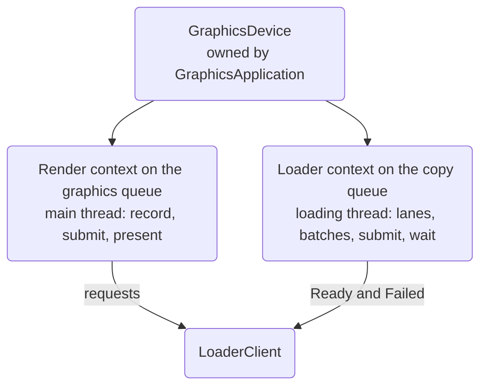
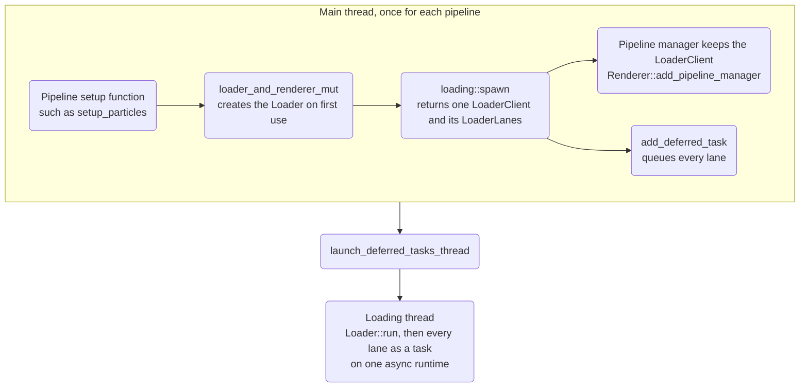
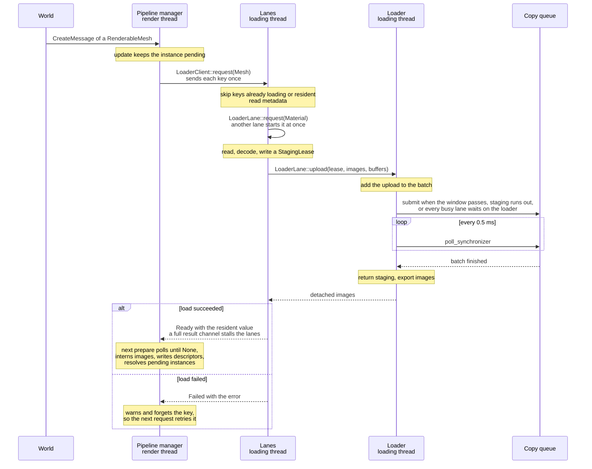

Read this page before you change resource loading, texture or mesh uploads, a
rendering pipeline's loader, or the graphics hardware interface (GHI) calls
they use. It explains how the
loader and the renderer share one GPU without waiting on each other, and which
rules keep it that way.

<Callout type="info" title="Change the rules on purpose">
	The rules on this page are the renderer's loading contract. If a change needs
	to break one, treat it as a design change: update this page in the same
	change and explain why.
</Callout>

## Two independent timelines

Rendering and loading run on separate timelines. Each has its own thread, its
own GHI context, and its own queue.

| | Render timeline | Loading timeline |
|---|---|---|
| Thread | The main thread | The loading thread that `launch_deferred_tasks_thread` starts |
| Context owner | `Renderer` | `Loader` |
| Queue | Graphics queue | Copy queue |
| Work | Records, submits, and presents frames | Reads, decodes, stages, and copies resources |

Both contexts come from one `GraphicsDevice`. `GraphicsApplication` creates it
at startup and keeps it until both contexts are dropped. Neither timeline owns
the other.



The only link between the timelines while the app runs is each pipeline's
`LoaderClient`. The render thread sends requests and adopts `Ready` and `Failed`
notifications. It knows nothing else about the loader.

## How a pipeline joins the loading timeline

Each pipeline manager that loads resources, such as `VisibilityPipelineManager`,
`SimplePipelineManager`, and `ParticleManager`, connects to the loader once, at
startup, before the loading thread starts:



A pipeline set up after `launch_deferred_tasks_thread` can't add lanes, so set
up every pipeline first.

## How a resource becomes resident

The diagram follows one mesh from the scene to a drawn instance. Every pipeline
manager and every resource family follows the same path.



1. A pipeline calls `LoaderClient::request` on the render thread.
2. A lane on the loading thread picks up the request and reads the resource's
   metadata. It requests every resource that metadata names, such as a mesh's
   materials or a material's textures, with `LoaderLane::request`. Other lanes
   start loading those right away, in the order their
   [priorities](#how-lanes-prioritize-requests) set.
3. The lane reads and decodes the resource, and writes its bytes into a
   `StagingLease`.
4. The lane hands the loader an upload as plain data through
   `LoaderLane::upload` or `upload_native_image`.
5. The loader adds the upload to the current batch, submits the batch on the
   copy queue, and waits for it without blocking its thread.
6. When the batch finishes, the loader returns its staging to the arena, exports
   each finished image from the loader context, and answers the lane.
7. The lane sends `Ready` with a resident value that holds detached images, never
   handles.
8. On its next frame, the pipeline polls its client, interns the images into the
   render context, and writes descriptors with samplers it owns. Resources can
   become ready in any order, so adopt each one on its own.

## How lanes prioritize requests

Lanes load what keeps something from drawing before what only refines it.
`LoadPipeline::priority` ranks every request as one of two `Priority` values,
and ranks it `Needed` unless the pipeline overrides it:

- `Needed`: something can't draw until the request loads.
- `Background`: the request improves something that already draws, such as a
  finer detail level or a full mip chain.

A dependency that a lane requests takes its own priority, not the priority of
the load that requested it.

Each priority has its own queue. Every submission goes through one path,
whether it comes from `LoaderClient::request`, `LoaderClient::reload`, or
`LoaderLane::request`: it joins the queue of its priority, then rings a
doorbell, which is a queue of empty tokens.

`loading::spawn` takes a `lane_count` and a `background_lane_count`, and splits
the lanes into two kinds:

| Lane | Count | Takes |
|---|---|---|
| Needed lane | `lane_count - background_lane_count` | Needed requests only. It waits on the needed queue. |
| General lane | `background_lane_count` | A needed request when one waits, and a background request otherwise. It waits on the doorbell only after it found both queues empty. |

A pool of one lane has one general lane. `spawn` panics on a split that leaves
no general lane, or, with more than one lane, no needed lane.

The visibility pipeline runs four lanes, two of them general, and ranks these
requests as background:

| Request | Why it can wait |
|---|---|
| `MeshLevels` | The mesh already draws with its coarsest levels, which load with it. |
| `TextureDetail` | The texture already draws with its coarse mips. |
| `Lightmap` | An instance draws once its renderable, materials, and textures are ready, and adopts its lightmap whenever it arrives. |

Every other visibility request is needed. The other pipelines rank every
request as needed and use one general lane, so every lane takes every request.

A change here must keep these true:

- A needed request never queues behind a background one. A free lane of either
  kind takes it first, and a burst of needed requests can use every lane that
  isn't already loading background work.
- At most `background_lane_count` background loads run at once.
- Background requests always load: a general lane takes one whenever no needed
  request waits.
- No submission goes unseen. Its token joins the doorbell after the submission
  joins its queue, and a general lane checks both queues before it waits.
- Dropping the `LoaderClient` closes every queue, so idle lanes stop even though
  each lane can still request dependencies.
- A request is background only when nothing waits for it to draw. If instances
  ever wait for their lightmaps before they draw, rank `Lightmap` as needed.

The default test run covers these rules:

| Test | What it checks |
|---|---|
| `needed_requests_start_before_queued_background_requests` | A needed request starts on a needed lane while background requests queue, and a free general lane takes a needed request before a background one. |
| `background_loads_never_exceed_the_background_lane_count` | A backlog of background requests never runs on more lanes than the general lanes, and all of it loads. |
| `needed_bursts_use_every_lane` | A burst of needed requests runs on every lane at once. |
| `background_requests_drain_without_needed_work` | Background requests load when no needed request waits, on a pool of one lane. |
| `dependencies_queue_by_their_own_priority` | A lane's dependency takes its own priority, not the priority of the load that requested it. |
| `dropping_the_client_stops_needed_and_general_lanes` | Every lane of both kinds stops once the client is dropped. |

`a_split_without_a_general_lane_panics` and
`a_split_without_a_needed_lane_panics` check that `spawn` rejects a split that
would starve one priority.

## How visibility instances wait for meshes

Each renderable handle has one lifecycle record: waiting for a mesh, or
resident and owning its primitive slots. The scene indexes records by handle
and waiting instances by mesh. Creation replaces only that handle's existing
state; a new handle needs no cleanup. Mesh completion transitions only its
waiters to resident. Deletion removes the record and releases its primitive
slots and any posed vertex ranges. A failed mesh load removes its waiters
through the same cleanup path.

Removing a waiter swaps the last handle into its place and updates that
handle's index. This keeps insertion and removal independent of the number
of waiting instances. Don't scan all waiting instances on creation: a scene
with many instances of a shared mesh would take quadratic time to start.

This lifecycle doesn't duplicate resource state. Materials still determine
draw readiness through the availability graph, and mesh detail residency stays
shared across instances. The transition tests live in
`rendering::pipelines::visibility::renderables`.

## How mesh detail levels stream

The visibility pipeline loads each mesh's detail levels from coarse to fine as
instances want them, so memory follows what the camera needs rather than the
size of every loaded mesh. The
[detail level rules](/docs/reference/rendering#the-visibility-pipeline) define
the behavior; this section explains how it's built.

- A mesh lives in two blocks of the geometry buffers. The base block holds each
  primitive's coarsest level. It loads with the mesh, never moves, and is never
  released, so rays hit it and acceleration structures are built once per mesh.
  A primitive's coarsest level is its own last level, not a level number the
  mesh shares, so a primitive with few levels doesn't pull the others' full
  detail into the base.
- Each primitive has its own finer block, which holds its levels from its finest
  resident level down to, but not including, its coarsest. Primitives refine
  independently, so a large mesh holds full detail only where the camera is
  close. The baker orders vertices coarsest level first, so those levels need a
  prefix of the primitive's vertices. Moving one level finer loads a new block
  and retires the old one. That re-reads the coarser levels, which are no
  larger than the new one, but it never moves geometry another frame still
  reads.
- `PreparedLevels` names which levels of each primitive a preparation holds.
  Each held level gets a `ShaderMeshLevel` record, in a geometry stream of its
  own, that names its meshlets, its first vertex, and the sphere its meshlets'
  bounds are stored within. Meshlet and level records count from the start of
  the prepared streams, and each prepared primitive records its own elements of
  every stream, so `GeometryBuffers::append_primitives` places each primitive in
  ranges of its own. `PreparedMesh::place_records` then rewrites the records in
  the staging lease for where they landed, once per placement, before the copy.
  Each primitive's `MeshLods` marks the levels it can draw and names their
  records. `MeshLods::drawn` picks the finest resident level that isn't finer
  than the one an instance wants, so switching an instance's level rewrites one
  index in its instance record.
- `MeshResidencies` decides what loads and what goes. Each followed primitive
  has a slot, which its render entities keep, so recording the level an
  instance wants is an array write. Once a frame, each mesh without a load in
  flight asks for the next finer level of every primitive that wants more, in
  one load. A level stream holds every primitive of its mesh, so one load reads
  and decodes it once however many primitives refine. A primitive without room
  releases the finer block that went unwanted the longest and waits for the
  frames in flight before trying again. With nothing to release, it waits
  longer. It's never dropped, and it keeps drawing what it has.

A change here must keep these true:

- An instance never draws a level that isn't resident.
- A block is released only after the frames that read it finish on the GPU.
- A resident mesh's base block is never released.
- A mesh has at most one load of finer levels in flight.
- A level record lives and retires with the meshlets it names, so a record an
  instance can name always names resident geometry.

The residency decisions are tested in `rendering::pipelines::visibility::residency`, and the level table in
`rendering::pipelines::visibility::lod`.

## How merged meshes build

A merged mesh draws many static copies of one resource mesh as one mesh, so
the renderer handles a patch of grass instead of each tuft. The level bake
[clusters the placements](/docs/develop/resource-management/level-merging) and
the [merged mesh rules](/docs/reference/rendering#the-visibility-pipeline)
define the behavior. Storing merged geometry would repeat the mesh once per
copy on disk, which took 5 GiB for one test scene, so it's built in memory
instead.

- `MeshSource::Merged` names the resource mesh and the placements. Its key
  hashes both, once, when the source is made.
- `MergedSource`, in `geometry/prepare/merged.rs`, is the resource mesh read
  whole into memory: every vertex, and every level's meshlets. The loader reads
  it once per resource mesh and keeps it, so building a level reads nothing
  from the store.
- The base load places no geometry. It publishes each primitive's bounds and
  level table with no level resident, so the mesh costs nothing until it's
  drawn.
- `MeshResidencies::add_merged_mesh` follows the mesh in exact mode: each
  primitive asks for the level its instances want whenever it holds another or
  none. The request reuses `PrimitiveLevels`, where `finest` names the one
  level to build.
- `PreparedMesh::merged` builds that level by repeating the source level once
  for each copy. It transforms positions and normals, offsets each copy's
  meshlet vertex indices, and copies each meshlet with its sphere and cone
  transformed. It clusters nothing, so a build is a straight copy.
  `GeometryBuffers::append_primitives` then places it like any block.
- `SourceLevel::pack` joins consecutive meshlets, of one copy and of the
  copies after it, into one while they fit a meshlet. A small mesh bakes into
  meshlets far below a meshlet's size, so without packing a patch of small
  tufts draws one meshlet for each tuft. Only neighbors in the list join, which
  keeps the build a copy; the level bake lists a cluster's placements along a
  Z-order curve so that neighbors in the list are neighbors in space.
- `LodView::sees` decides whether a merged instance is in view, from the
  camera frustum and the directions the suns' light travels. The instance
  rebuild records a wanted level only for an instance in view, so a cluster
  nothing can see builds nothing, and its level becomes the first to release.

A change here must keep these true:

- A merged primitive holds one level, so a block's vertices are that level's
  alone and each copy's meshlets index its own run of them.
- A mirrored copy swaps two corners of each triangle, and a copy with a
  non-uniform scale gets a cone that never culls.
- The level bake and `MergedSource::primitives` agree on how many copies fit
  one primitive, so a baked cluster always loads.
- A merged mesh keeps no flat triangles, so rays and the lightmap bake skip it.
- A merged level's record holds the radius of its largest copy as its
  `caster_radius`, so cascades skip a patch of small copies as they would skip
  each copy; see [shadow maps](/docs/develop/rendering/visibility/shadow-maps).
- Packing depends only on the meshlets' counts and order, so the meshlet count
  a level table reports before a build matches what the build writes.
- The in-view test never rules out what the camera sees. It may keep an
  instance that isn't visible, never the reverse. Shadows that point and cone
  lights cast from clusters outside the camera's view aren't followed.

`geometry/prepare/merged.rs` tests the builder and the packing,
`a_merged_mesh_loads_exactly_the_level_wanted_finer_or_coarser` in
`residency.rs` tests the residency rule, and
`an_instance_is_seen_in_the_frustum_or_when_a_sun_carries_its_shadow_there` in
`lod.rs` tests the in-view rule.

## How texture mips load

Material textures in the visibility pipeline load their coarse mips first, so
the materials that sample them draw before their full mip chains arrive. The
[texture readiness rules](/docs/reference/rendering#the-visibility-pipeline)
define the behavior; this section explains how it's built.

The scene set holds three texture arrays, which `TextureArray` names:
`textures` for material textures, `ies_profiles` for lights' IES profiles, and
`lightmaps` for baked lightmaps. Each has its own slots, and the sampler its
`scene.besl` declaration fixes: material textures repeat and filter
anisotropically, and the other two clamp. Fixed samplers take no slots of the
set, which keeps the scene set within Direct3D 12's 2,048 sampler heap
entries. IES profiles and lightmaps load their full mip chain at once.

- `load_texture` takes the first mip to load and creates an image whose base
  level is that mip. A sampler picks mips from the image's own extent, so the
  smaller image samples like the full one with its finer mips missing, and
  shaders need no change.
- A `Texture` request loads the mips from `coarse_first_level` on: the first
  mip no larger than 128 texels. Once that upload finishes, the lane requests
  the full chain as a separate `TextureDetail` request. It's a
  [background request](#how-lanes-prioritize-requests), so it waits for every
  needed request, including the coarse mips of every texture already waiting.
- Both loads use the same slot of `textures`. `VisibilityLoaderClient` keeps
  the image in each slot of each array and the mip it starts at. An image with
  more mips replaces the slot's image. Once the frame's writes put the new
  image in the slot, the old one goes to `Frame::delete_image`, which frees it
  when the frames in flight finish. An image with fewer mips than the slot
  holds, such as coarse mips that arrive after their full chain, is dropped
  before it's interned.
- A texture is available to materials from its first image, so the full chain
  doesn't change any material's readiness or rebuild the material lists.

This keeps the loading contract: the loader never writes an image the render
context holds. The coarse mips load twice, about four thirds of the 128-texel
mip's size per texture: 21 KiB for BC7, 85 KiB for RGBA8.

A change here must keep these true:

- A slot never goes back to an image with fewer mips than it holds.
- A replaced image goes to `delete_image` only after no descriptor set binds
  it. GHI panics otherwise.

`textures_load_from_a_first_mip_level` tests the image a load from a later mip
creates, and `coarse_mips_start_at_the_first_level_no_larger_than_the_coarse_extent`
tests the policy.

## Rules that keep rendering independent

Keep these rules when you change loading. Each one prevents a regression that
already happened once or that this design exists to avoid.

- **The render thread never waits on the loader.** It doesn't share a lock with
  the loader, record loader copies, or wait on a loader fence. It only adopts
  notifications.
- **The renderer doesn't own the loader.** `GraphicsApplication` owns the
  `GraphicsDevice` and creates the `Loader` when the first pipeline asks for it
  with `loader_mut`. `launch_deferred_tasks_thread` moves the loader to the
  loading thread. Don't create, hold, or start the loader from `Renderer`.
- **A notification means the upload is complete.** The loader answers a lane
  only after its batch finished. Anything a `Ready` names can be used in the
  frame that adopts it, without a wait.
- **Resources cross contexts only through GHI.** Images move with `export_image`
  and `intern_image`. Render buffers that lanes write are shared once, at setup,
  with `share_buffer` and `import_buffer`. A resident value never carries a
  loader-context handle.
- **Resource state travels with the resource.** When a backend needs state from
  the loading timeline, such as a Vulkan image layout, keep it in the exported
  image and restore it in `intern_image`. Don't add render-side logic about
  loader work.
- **Lanes schedule dependencies.** A load requests the resources its metadata
  names as soon as it reads them, before its own upload, and never waits for a
  render frame to relay them. Lanes coalesce requests where they pick them up, so
  a resource with several parents loads once. To load a changed resource again,
  call `LoaderClient::reload`. The resources it depends on stay resident.
- **The loader owns all GPU work of loading.** Lanes do CPU work and file I/O
  only. They never touch a context. The one exception is the bottom-level
  acceleration structure that ray tracing needs for each mesh: the copy queue
  can't build it, so the visibility pipeline builds it on the render context,
  a frame's budget of triangles at a time, once a frame draws the mesh.
  `todo.md` tracks moving these builds to the loading timeline.
- **Lanes write only free ranges of shared buffers.** The visibility pipeline
  places each mesh in free ranges of every geometry stream that
  `GeometryRanges` tracks. A released mesh's ranges become free only after the
  frames that drew it finish on the GPU, so a lane never writes ranges a frame
  still reads. A lane publishes a range only after its copy finished.
- **Samplers belong to pipelines.** A pipeline creates its few samplers at setup.
  Loaded textures don't carry samplers.

## How the loader batches uploads

The loader collects uploads from every lane of every pipeline into one batch.
It submits the batch as soon as any of these is true:

- The batch window passed. Set the window in milliseconds with the
  `render.loading.batch-window` parameter. It defaults to 4.
- Staging ran out, so a lane waits for space that only a finished batch can free.
- Every busy lane is waiting on the loader, so waiting longer can't add an upload.
- Every lane is gone.

Only one batch is on the copy queue at a time. While it runs, the loader keeps
collecting the next batch, and lanes keep reading and decoding. The loader
checks the running batch with `Context::poll_synchronizer` every 0.5 ms instead
of blocking, because the lanes share its thread.

<Callout type="info" title="Why busy lanes end a batch early">
	A lane that loads a flipbook's frames one after another waits for each upload
	before it prepares the next. Without the busy-lane rule, each of those uploads
	waits out the whole batch window alone. In the isometric sandbox, that made
	loading slower than the old design until the rule was added.
</Callout>

## Follow the staging rules

All lanes share one 32 MB staging arena that the loader owns.

- Put all an upload's bytes in one lease, and hand the lease to the loader
  before you allocate another. If lanes hold unsubmitted leases while they wait
  for more space, a full arena deadlocks.
- Place each region relative to the start of its lease. The loader adds the
  lease's offset when it records the copy.
- Don't keep or drop the lease yourself after you hand it over. The loader
  returns it to the arena once the copy finished.
- An upload larger than the whole arena fails with an error instead of waiting.

## Why the design looks like this

The renderer and every loader lane used to share one GHI context behind a mutex.
Measurements in the isometric sandbox showed why that was too slow:

- The render thread held the lock through each frame, including while
  `acquire_swapchain_images` waited for the display. A loader could only take
  the lock in the short gap between frames.
- Each texture took the lock three times: to intern its image, to record and
  submit its copy, and to wait for the copy.
- Lanes share one thread, so a lane blocked on the lock stopped every other lane
  and the staging worker too.
- A loader waited on the GPU while it held the lock, so the render thread could
  end up waiting on loader copies queued behind frame work.

Loading the sandbox's 23 startup resources on Metal, three runs each:

| | Shared context lock | Loading timeline |
|---|---|---|
| First upload to last resident | 241–568 ms | 105–124 ms |
| Time loaders waited on the lock | 131–351 ms | None |
| Frames until everything is resident | 21–58 | 5–7 |
| Render-thread tick interval, p95 | About 9.4 ms | About 9.4 ms |

When you change loading, measure it the same way. Run the isometric sandbox
with `--kill-after=600`, log timestamps for the first upload and for each
resource that becomes resident, and compare tick intervals while loading
against the steady state.

## Backend contract

The GHI's objects, resources, and per-backend support are specified in the
[graphics hardware interface reference](/docs/reference/ghi). A backend
supports the loading timeline when it provides every one of these:

- Several contexts from one device, each of which can move to another thread.
  Contexts that submit to the same native queue share one lock.
- A copy queue, requested as `WorkloadTypes::TRANSFER` next to the graphics queue.
- `Context::export_image` and `intern_image`, which move an image and its
  tracked state between contexts. A detached image dropped before it's interned
  frees its memory.
- `Context::share_buffer` and `import_buffer` for static buffers. The importing
  context only records copies with the handle, and the owning context sees those
  writes before it next reads the buffer.
- `Context::poll_synchronizer`, which reports completion without blocking.

Metal implements the contract. Vulkan and DX12 don't yet, so Linux and Windows
builds fail until they do. `todo.md` lists what each backend needs.

## Run the tests that guard the design

Run these tests when you change loading or the GHI calls in the backend
contract. They need a GPU, so the default Nextest profile skips them:

```bash
cargo nextest run --ignore-default-filter -p byte-engine-ghi --test rendering
cargo nextest run --ignore-default-filter -p byte-engine --test loading
```

| Test | What it checks |
|---|---|
| `exported_image_keeps_contents_and_mips` | An image filled in one context keeps its contents and mip count in another. |
| `imported_buffer_receives_copies` | A context sees the copies another context made into its shared buffer. |
| `polled_synchronizer_reports_completion` | Polling reports completion without blocking and frees the synchronizer. |
| `uploads_are_visible_when_ready_even_beyond_staging_capacity` | Uploads larger than the staging arena all finish, and each `Ready` arrives only after its bytes landed. |
| `dependencies_load_once_without_render_requests` | Lanes load the dependencies a load names without a render-side request, and a resource with two parents loads once. |
| `textures_load_from_a_first_mip_level` | A texture loaded from a later mip is an image whose base level holds that mip, at that mip's extent. |

The default test run also covers
`full_arena_reports_exhaustion_until_a_lease_returns`, which checks the signal
that ends a batch when staging runs out, and the
[lane priority tests](#how-lanes-prioritize-requests).

## Known limits

- Lanes are cooperative tasks on one thread. A long synchronous decode step
  delays batch submission and completion checks.
- A background load that started keeps its general lane until it finishes. While
  every general lane loads background work, needed requests have only the needed
  lanes.
- Each batch costs one copy-queue round trip, about 0.75 ms on Metal. A lane that
  loads a flipbook's frames one after another pays it for every frame. Load the
  frames concurrently to let them share a batch.

## Related API

- [`rendering` module](/docs/api/latest/byte_engine/rendering): the `loading`,
  `resource_loading`, and `device` modules and their types.
